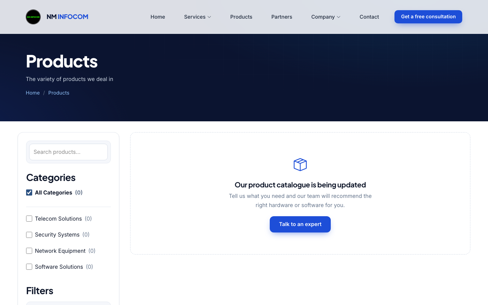

# NM INFOCOM: redesign, CRM rebuild and security report

**Date:** 29–30 October 2026 · **Repository:** `ManasNikte/NM-Infocom-Website` (`main`) · **Scope:** public website, internal CRM, server configuration

This report covers the work done on the NM INFOCOM website and CRM: the problems found, what was changed, how it was
tested, and what remains to be done before and after going live.

---

## 1. Summary

| Area | Before | After |
|---|---|---|
| Public website | Template look (serif fonts, green accent, image carousel), several broken links and images, broken newsletter and review forms | Modern design system, conversion-focused homepage, new Web Development page, every form working and protected |
| CRM | Copy-pasted pages per role, many dead or broken features, dummy numbers on dashboards | One shared layout and component style, live data everywhere, about 90 dead/test files removed |
| Security | Unauthenticated account creation, forgeable sessions, executable uploads, stored XSS, no CSRF protection | Every endpoint authenticated and role-checked, uploads locked down, output escaped, CSRF and brute-force protection |
| Secrets | Database password, JWT key and a Cloudflare secret hard-coded in the repository | All secrets in a git-ignored `.env`, the CRM refuses to run without a strong JWT key |
| Images | 51 MB of images (one 24 MB hero photo) | 9.5 MB, no visible quality loss |
| Admin | Could only see admin pages | Can open every manager and employee desk and do anything those roles can, recorded under the admin's account |
| Live data | 16 pages re-fetched their tables every 3 seconds, even in background tabs (~1,200 requests/hour per tab) | Refresh on returning to the tab and instantly across open CRM tabs; idle pages make no requests |
| Website content | Team, logos, stats, why-us, FAQs and slides editors only showed "Demo only"; newsletter page was fake data | Real add / edit / delete for all of them; newsletter on real subscribers with CSV export |

---

## 2. Public website

### 2.1 Design system
A single stylesheet, `assets/css/nm.css`, loads after the template's `main.css` and restyles every page:
navy/blue palette, Inter + Plus Jakarta Sans type, consistent cards, buttons, forms, page banners and footer, a light
sticky header with a "Get a free consultation" call to action (also inside the mobile menu), and responsive layouts down
to 375 px with no horizontal scrolling.

### 2.2 Homepage
Rebuilt around getting enquiries: hero with two calls to action and live stats, client logo strip, services, about,
stats band, a four-step "How we work" section, why-us, testimonials, team, FAQ, a "Free IT health check" banner and
a contact form shown next to phone, email and map.

| | |
|---|---|
|  |  |
|  |  |

### 2.3 Web Development page (new)
`webdev.php` presents NM INFOCOM as a web development company: built from scratch with no templates, end-to-end
delivery, and a review meeting with the client after every milestone. Sections: hero with a code/preview mock-up,
what we build, why hand-built beats templates, a six-step milestone timeline (each with its client meeting), technology
and working promises, FAQ, and a discovery-call CTA. Linked from the homepage services, header menu and footer.

| | |
|---|---|
|  |  |

### 2.4 Service pages
- **Unified cards.** On the overview pages (IT Security, IT Infrastructure, Mobility) cards had a fixed 500 px height,
  so on most cards the "Read more" link was pushed out of view even though the card stayed clickable. Cards now grow
  with their content and all show the same "Learn more →" link.
- **Dead links fixed.** 63 "Read more" links on detail pages pointed to `#` or to pages that never existed. They now
  read "Ask about this" and open the contact form with the relevant service preselected.
- **Missing images.** The Cloud page referenced six images that were never committed; it now uses suitable existing
  images. Manish Nikte's team photo pointed at the wrong file extension.
- Each page has its own `<title>` and meta description, and a consultation banner above the footer.

| | |
|---|---|
|  |  |

### 2.5 Careers, Events and Blog
| Page | Problems found | Now |
|---|---|---|
| **Careers** | 900+ lines of page CSS; skills echoed without escaping; fake fallback jobs ("New York, $120k") shown when the DB was unavailable; SweetAlert pop-up form | Hero with stats, team/type/search filters, expandable job details (duties, requirements, skills, closing countdown), accessible application modal with PDF upload, general applications, hiring-process and perks sections, `JobPosting` structured data |
| **Events** | Ignored the database and served a hard-coded list with hand-set "scheduled/completed" flags, so 2024 events showed as upcoming in 2026 | Reads the database and classifies every event by its date and time in IST on each request; featured next event with countdown and registration; past events filterable by year/format; `Event` structured data. The CRM events list shows the same Upcoming/Past badge |
| **Blog** | Articles were only an excerpt; links pointed to `blogs.php` (404 on case-sensitive hosting); the CRM blog editor was a demo that saved nothing | Featured post, topic filters and search, full article pages (formatting, share buttons, related posts, `BlogPosting` data); a working CRM editor with article body, cover upload, draft/publish/hide, featured flag and automatic read time |

| | |
|---|---|
|  |  |
|  | |
|  |  |

**Demo content removed.** All demo blog posts (with comments), events (with speakers and photos), job openings and the
test applications made to them were deleted, so these pages now show their empty states until real content is added
from the CRM.

**Indian rupees everywhere.** Salaries are normalised to ₹ with Indian digit grouping (`Rs. 700000` → `₹7,00,000`,
`6 - 9 LPA` → `₹6 - ₹9 LPA`) and the CRM job forms reject amounts in $, USD, € or other currencies. Product prices,
the enquiry total and the price filter are shown in ₹ as well. Seven tables that could not store "₹" (latin1) were
converted to utf8mb4.

### 2.6 Forms and content
| Form | Problem | Fix |
|---|---|---|
| Newsletter | Required a paid template library that wasn't installed; nothing was stored | New `newsletter_subscribers` table and endpoint |
| Review | Inserted into non-existent columns, so it always failed; hard-coded Cloudflare secret | Rewritten; Cloudflare Turnstile removed in favour of a honeypot and rate limit |
| Product enquiry | Returned stack traces to visitors; enquiry counter never updated | Rewritten; counts enquiries; uses the catalogue's product name |
| Job application | Saved uploads with the visitor's extension (remote code execution risk) | PDF-only by content, 5 MB limit, server-chosen file name |
| Contact | Stored HTML-encoded text, no spam protection | Plain-text storage, validation, honeypot, rate limit |
| Catalogue download | Empty link reopened the page; no forced download | `data/download_catalogue.php` streams the PDF as an attachment; button hidden when there's no catalogue |

The product catalogue was cleared (all 16 products and their files deleted) and the products page now shows a friendly
empty state that points to the contact form.

---

## 3. CRM

### 3.1 Structure
Every section (admin, five manager departments, three employee departments) had its own copy of the header, sidebar,
footer, profile page, leave portal and dozens of near-identical data endpoints. These were consolidated:

- `CRM/layout/`: one page shell (sidebar, top bar, mobile drawer) and shared page bodies (profile, staff directory,
  team list, leave portals).
- `CRM/shared/`: one endpoint per feature, scoped to the signed-in user's role and department (profile, password,
  own leaves, team leaves, own tasks, task status, assign task, add/fire user, previous deals, add lead).
- About 90 dead, test and debug files deleted (including an exposed `phpinfo.php`).

### 3.2 Visual redesign
Dark navy sidebar with active states, slim top bar with page title and user, light canvas, and restyled cards,
tables (natural column widths with horizontal scroll instead of crushed columns), buttons, inputs, badges, pagination
and modals, applied centrally over the legacy theme. The 1 to 2 second fade-in on every page was removed.

Later in the project the dashboards were redesigned again:

- **Dark and light mode** with a toggle in the top bar (follows the device until chosen; saved per browser).
- **Greeting banner and live KPI tiles** on every dashboard (`CRM/layout/dashboard_hero.php`): pending, overdue and
  due-this-week tasks, completion rate, leave, plus leads, vendors, jobs or the website inbox for the department.
  Tiles fill their rows (6 tiles = 4 + 2 stretched), and card grids have no half-empty rows at any width.
- **One chart style** (`CRM/layout/crm-charts.js`): a single palette that keeps colour meaning, rounded bars, smooth
  gradient lines, theme-aware axes and tooltips, and "No data yet" instead of blank charts.
- **Pop-up forms** restyled for both themes; a new **My Profile** page; phone layouts for every page.

| | |
|---|---|
|  |  |
|  |  |
|  |  |
|  |  |
|  |  |
|  |  |

### 3.3 Functional fixes (selection)
- **Admin dashboard and departments**: replaced 14 hard-coded charts and four fake stat tiles with live data.
- **Charts on every manager/employee dashboard** drew partial pies because two Chart.js versions overrode each other;
  fixed and pinned.
- Profile and password changes, leave editing, HR employee search (SQL syntax error), purchase "Add lead", previous
  vendor deals (sample data), purchase dashboard showing marketing's tasks, dashboard "Assign task" lists, website
  analytics cards (hard-coded `/NM-Infocom/` URLs), product image paths, leave dates shown a day early.
- Managers can only approve leave, assign tasks to or fire employees in **their own department**.

### 3.4 User management
- All non-admin users were removed (the admin account is kept so the team can be added again).
- **Add user** (admin): any role, including Admin. HR managers can add managers and employees.
- The new user is emailed the sign-in link, their email and a random 12-character temporary password via SMTP
  (PHPMailer). If sending fails, the admin sees the error and the password once.

### 3.5 Admin workspaces
The admin can open every manager desk (HR, Marketing, Sales, Purchase, Website) and the Marketing, Sales and Purchase
employee desks from **Work as** in the sidebar. An amber bar shows the role in use, with a switcher and *Back to admin*.

The server works out the desk from the page's own folder, or for `CRM/shared/` endpoints from the same-origin page
that called them (`crm_admin_workspace_token()`), and treats the admin as that desk's manager or employee, so every
existing department rule applies unchanged. Only admin tokens are ever converted, and records keep the admin's own
user ID. Tested: the admin hired staff, posted a job, assigned a task, approved leave, added vendors and leads and
updated a sales lead from the desks; employees and managers can't borrow this, and foreign Referers are ignored.

| | |
|---|---|
|  |  |

### 3.6 Live data without polling
Sixteen pages (leave portal, vendors, leads and every website editor) re-fetched their table every 3 seconds with
`setInterval`. They now use `crmLiveRefresh()` (`CRM/layout/crm-ui.js`), as do every dashboard's tiles, charts and
task tables: data reloads when you come back to the tab after 30 seconds, and immediately when you save something in
another open CRM tab (the browser's BroadcastChannel, so no server traffic). Pages remember their current page,
search and filters when they refresh. A browser audit of all 81 page loads found **zero requests while idle**.

### 3.7 Website content editors and newsletter
- Team, client logos, stats, why-us cards, FAQs, hero slides and site details had edit/delete buttons that only showed
  "Demo only" alerts. They now save through one endpoint, `manager/website/data/content_admin.php`, which whitelists
  each table and field, validates every value (links must be `https://`, numbers must be numbers), and stores images
  through the content-checked upload helper. Seven of these tables had no primary key or auto-increment ID in the
  database, which is why nothing could ever be added; `2026_10_30_content_primary_keys.sql` fixes that.
- The newsletter page showed hard-coded people and campaign numbers. It now lists the real `newsletter_subscribers`
  with live counts, search, status filter, unsubscribe/resubscribe, delete and a CSV export (spreadsheet formulas
  neutralised).
- Events: editing no longer wipes the location, shows the current image, and can set the *Register* link; replaced
  images are deleted. Products: a new catalogue or cover is stored before the old file is removed, so a failed upload
  can't leave a product pointing at a missing file.
- The separate WitJab website pages (portfolio, reviews, web data) and their database connection were removed.

---

## 4. Security assessment

### 4.1 Findings and fixes

| Severity | Finding | Fix |
|---|---|---|
| Critical | `HR/data/add_emp.php` and public `signup.php` let anyone create users, including admins, with no login | Endpoints require Admin/HR; signup is admin-only; roles whitelisted |
| Critical | Several endpoints base64-decoded the JWT without verifying its signature, so any user could be impersonated | All auth goes through `CRM/config/auth.php` (verified HS256) |
| Critical | Public résumé upload kept the visitor's file extension in a web folder with no execution block | PDF check by content, forced `.pdf`, `uploads/.htaccess` disables scripts |
| Critical | JWT signing key was a public placeholder | Key must come from `.env` (32+ chars); CRM refuses to run otherwise |
| High | Most CRM write endpoints had no authentication or role check | `crm_require_api(roles, department)` on every endpoint |
| High | Stored XSS: public submissions (contact, reviews, applications) rendered as HTML in the CRM | Global `esc()` applied to 949 template interpolations; PHP output escaped; verified with a live payload |
| High | Event/catalogue uploads kept client extensions; deletes trusted DB paths | `crm_store_upload()` / `crm_delete_upload()` with MIME mapping and path containment |
| High | Hard-coded Cloudflare Turnstile secret | Removed (feature dropped); rotate the key in Cloudflare |
| Medium | No CSRF protection on cookie-authenticated endpoints | `SameSite=Lax` cookie + cross-site request rejection |
| Medium | No brute-force protection on sign-in; fired users could sign in | 10 failures / 15 min per IP; inactive accounts blocked |
| Medium | Public forms had no rate limit or spam protection; stack traces returned | Honeypot, per-IP limits, generic errors |
| Medium | PHP errors displayed to visitors; debug/test pages reachable | `display_errors` off unless `APP_DEBUG=1`; files removed; `.htaccess` hardening |
| Low | Missing security headers, directory listings | Headers and `Options -Indexes` in `.htaccess` and PHP |

**Second audit (30 October 2026).** Every endpoint and page was reviewed again line by line in three parallel
passes (admin/shared, department desks, website and public site). About 60 issues were confirmed and fixed:

| Severity | Finding | Fix |
|---|---|---|
| High | Stored XSS: public review text, applicant names, lead names, task text and vendor names reached `innerHTML` unescaped, including values read back from `data-*` attributes into edit dialogs | Escaped everywhere; inline JSON handlers replaced by lookups; verified in a browser with payloads in every field |
| High | Review delete / publish worked over a plain link (GET), so a crafted link could act on a logged-in manager's behalf | POST only |
| Medium | Fired users kept access until their 24-hour session expired; a password change didn't end other sessions | Each request re-checks status, role and department; password change sets `tokens_valid_after` |
| Medium | Marketing manager could list and edit the purchase team's leads; sales employees could create and delete leads through hidden actions | Scoped to marketing; hidden actions removed |
| Medium | Lead statuses, responses, vendor fields and dates were stored unchecked; lead assignment accepted any user ID | Whitelists and checks (`shared/lead_update.php`); leads only go to active sales employees |
| Medium | Old SweetAlert v1 calls (fire employee, contact replies) and duplicate jQuery/Bootstrap loads that silently broke plugins | One SweetAlert2 dialog each; duplicates removed |
| Low | SQL errors, file paths and stack traces returned to users; request bodies logged; `Access-Control-Allow-Origin: *` on several endpoints | `crm_public_error()` logs and returns a generic message; debug logging and CORS headers removed |
| Low | Paging values of 0 or below crashed some lists; impossible dates (31 Feb) accepted; month comparisons wrong on the 29th–31st | Clamped and validated |

### 4.2 Verification performed
- Every CRM page and data endpoint requested as each of the nine roles: no PHP errors, unauthenticated requests get 401.
- Forged and old-key tokens rejected; cross-site POST rejected; login lock-out after 10 failures.
- Cross-user and cross-department attempts (edit another user's leave or task, approve another department's leave,
  assign/fire outside the department) all refused.
- A PHP shell uploaded as `.php` and as a fake `.pdf` was rejected; a real PDF accepted.
- An `` / `<script>` payload sent through the public contact form displayed as text in the CRM and did not run.
- New-user email received (Mailpit) and the emailed password signed in successfully.
- Real Hostinger SMTP: credential, task and leave emails accepted for every role.
- After the second audit: 63/63 security and function checks pass (session revocation, lead and vendor validation,
  content editors including image upload and rejection of a disguised PHP file, newsletter actions and CSV, error
  handling); 29/29 pages stay safe with script payloads planted in every user-editable field and their dialogs opened;
  81 page loads across all roles show data with no JavaScript errors and no idle requests.
- The whole site was crawled from a case-sensitive disk image (as on Linux hosting): 186 page loads and 441 linked
  files, no letter-case path errors.

### 4.3 Making the repository public
The original repository's history contains the old hard-coded Cloudflare secret, staff résumés and error logs, so the
public repository, `ManasNikte/NM-Infocom-Website`, was started from a fresh history with only the current files.
The original repository keeps the old history. Rotate the Cloudflare Turnstile key and any database password that
was ever committed there.

---

## 5. Performance

| | Before | After |
|---|---|---|
| Images in the repository | 51.2 MB | 9.5 MB |
| Largest image (`hero/3.jpg`) | 23.9 MB, 6500 px | 0.5 MB, 2400 px |
| Event photos | 1.1 MB each | ~0.2 MB each |
| CRM page reveal | 1–2 s fade-in | immediate |
| CRM front-end libraries | 8.2 MB in `CRM/vendor`, 20 stylesheets + 14 scripts per page, three icon sets | under 1 MB, 7 stylesheets + 5 scripts; Chart.js only on pages with charts |
| Background requests | ~1,200 per hour per open tab on 16 pages | none while idle |
| Database | primary keys only | indexes on the per-person / per-status lookups every dashboard makes |

Photos were capped at 1920 px (hero 2400 px, team 480 px), re-encoded (JPEG q82 progressive, WebP q80), metadata
stripped and only replaced when at least 10% smaller. Text responses are gzip-compressed and static files get
browser caching (`.htaccess`). Two photographic PNGs were converted to JPEG. Unused template
images, orphaned event uploads and a 1.9 MB unused graphic were deleted.

---

## 6. Deployment checklist

1. Create `.env` above `public_html` from `.env.example`: database, `CRM_JWT_SECRET`, SMTP (Hostinger mailbox).
2. Back up the database, then apply `database/migrations/*.sql` in filename order (see the README's
   *Updating an existing Hostinger site* for the 30 October list). Delete the old `witjab` database if it exists.
3. Confirm PHP 8.1+ and that `.htaccess` files are honoured.
4. Sign in as admin, add a test user and confirm the email arrives.
5. Rotate the Cloudflare Turnstile secret (section 4.3).
6. When HTTPS-only, enable the HSTS header in `.htaccess`.

## 7. Known limitations and follow-ups
- Unused tables `benefits` and `blog_comments` are dropped by `2026_10_30_drop_unused_tables.sql`.
- Two partner logos (Slashgain, TruBI) were never uploaded; the Partners page shows their names instead.
- `leads.added_by` / `assigned_to` are text columns holding user IDs; converting them to integers would allow
  foreign keys but needs a data check first.
- `firebase/php-jwt` v6 has a low-severity advisory about weak keys; mitigated by the 32-character minimum. Upgrading to v7 is recommended.
- Content to review: test reviews on the homepage, expired job openings, placeholder social links (currently hidden),
  product photos for the new catalogue.
- The homepage hero is fixed copy, so hero slides edited in the CRM are not shown on the homepage.
